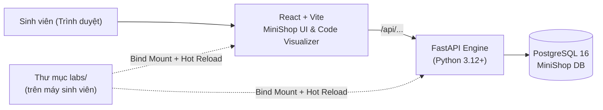
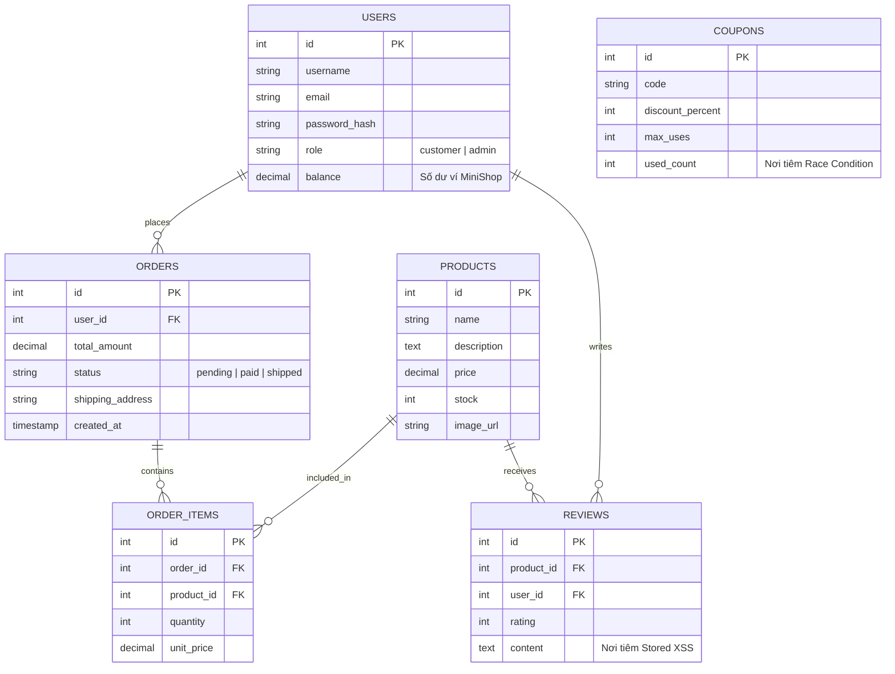

# 01. Kiến trúc Hệ thống & Database MiniShop

## 1. Kiến trúc Tổng thể (3 Service tinh gọn)

Hệ thống chạy hoàn toàn trên máy cá nhân của sinh viên qua `docker compose up`. Việc thống nhất một backend duy nhất (**FastAPI**) giúp cấu trúc cực kỳ gọn nhẹ, dễ đọc với sinh viên yếu code và dễ bảo trì.



### Nguyên tắc Local-First & Zero-Friction
* Sinh viên **không cần** cài tay Python, Node.js hay PostgreSQL.
* Chỉ cần cài Docker Desktop -> clone repo -> chạy `docker compose up`.
* Sửa file trong `labs/` bằng VS Code -> nhấn `Ctrl+S` -> cả **API đang chạy** (`uvicorn --reload`) lẫn **khung code trên web** tự động cập nhật ngay lập tức.

---

## 2. Cấu trúc Thư mục (Tách biệt `core/` và `labs/`)

Toàn bộ hạ tầng nằm gọn trong `core/`. Sinh viên chỉ cần mở thư mục `labs/` để đọc, học và tự sửa code.

```text
visual-vulnerable-webapp/
├── docker-compose.yml              # Chạy 3 service: frontend, backend, postgres
├── pyproject.toml & uv.lock        # Python uv workspace + pin version & quality config
├── AGENTS.md                       # SSOT quy chuẩn cho AI coding agents
├── README.md
├── docs/                           # Tài liệu thiết kế, Design System & ADRs (docs/adr/)
├── scripts/                        # Quality checkers & unified gate runner (gates.py)
│
├── core/                           # [HẠ TẦNG] Sinh viên không cần đụng vào
│   ├── frontend/                   # React + Strict TypeScript (Vite) + Tailwind v4 + pnpm
│   │   ├── src/
│   │   │   ├── components/         # Barrel index.ts + LabWorkspace, TopControlBar, ...
│   │   │   ├── lib/                # Barrel index.ts + api.ts
│   │   │   ├── types/              # Barrel index.ts + API/Trace TypeScript types
│   │   │   └── styles/tokens.css   # Design System CSS Variables
│   │   └── vite.config.ts          # Proxy /api -> backend:8000
│   │
│   ├── backend/                    # FastAPI Engine (uv workspace member)
│   │   ├── app/                    # Modular barrels (__init__.py + __all__)
│   │   │   ├── main.py             # Entrypoint, CORS, mount dynamic routers
│   │   │   ├── core/               # Settings & cấu hình dùng chung
│   │   │   ├── api/                # Routers (health, labs, system)
│   │   │   └── schemas/            # Pydantic response/request schemas
│   │   └── pyproject.toml          # Pinned backend dependencies
│   │
│   └── postgres/
│       ├── init.sql                # Tạo user phân quyền + bảng MiniShop
│       └── seed.sql                # Dữ liệu mẫu MiniShop (dùng cho Reset Lab)
│
└── labs/                           # [BÀI HỌC] Phẳng, rõ ràng cho sinh viên
    ├── 01-sql-injection/
    │   ├── meta.json               # Metadata, payload mẫu, test verify
    │   ├── README.md               # Giải thích ngắn gọn
    │   ├── backend/
    │   │   ├── vulnerable.py       # Sinh viên mở trực tiếp file này để sửa
    │   │   └── secure.py
    │   └── frontend/
    │       └── LabView.tsx         # Màn hình MiniShop riêng cho bài lab này
    │
    └── 02-xss-reviews/
        └── ...
```

---

## 3. Lược đồ Database MiniShop (PostgreSQL)

Tất cả các bài lab dùng chung một ngữ cảnh cơ sở dữ liệu **MiniShop** quen thuộc để sinh viên hiểu ngay mối liên kết dữ liệu:



### Phân quyền & Reset DB 1-Click
1. **`lab_app_user` (Quyền hạn chế):** Dùng cho toàn bộ endpoint bài lab. Chỉ có quyền `SELECT, INSERT, UPDATE, DELETE` trên schema `minishop` (không có `DROP`, `ALTER`, `SUPERUSER`).
2. **`lab_admin_user` (Quyền quản trị):** Chỉ dùng riêng cho `POST /api/system/reset-db` để chạy lại `seed.sql` khôi phục sạch dữ liệu MiniShop trong < 1 giây.

---

## 4. Cấu hình Hot Reload trong Docker Compose

| Service | Port Local | Cơ chế Hot Reload | Volume Mount |
| :--- | :--- | :--- | :--- |
| `frontend` | `5173` | Vite HMR (`pnpm dev --host`) | `./core/frontend/src` + `./labs` |
| `backend` | `8000` | `uvicorn app.main:app --reload` | `./core/backend/app` + `./core/postgres/seed.sql:ro` + `./labs` |
| `postgres` | `5432` | Reset nhanh qua `seed.sql` | `./core/postgres/init.sql:ro` + `./core/postgres/seed.sql:ro` |
