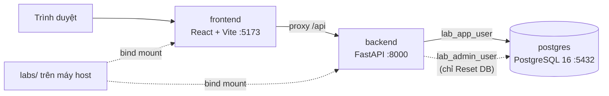
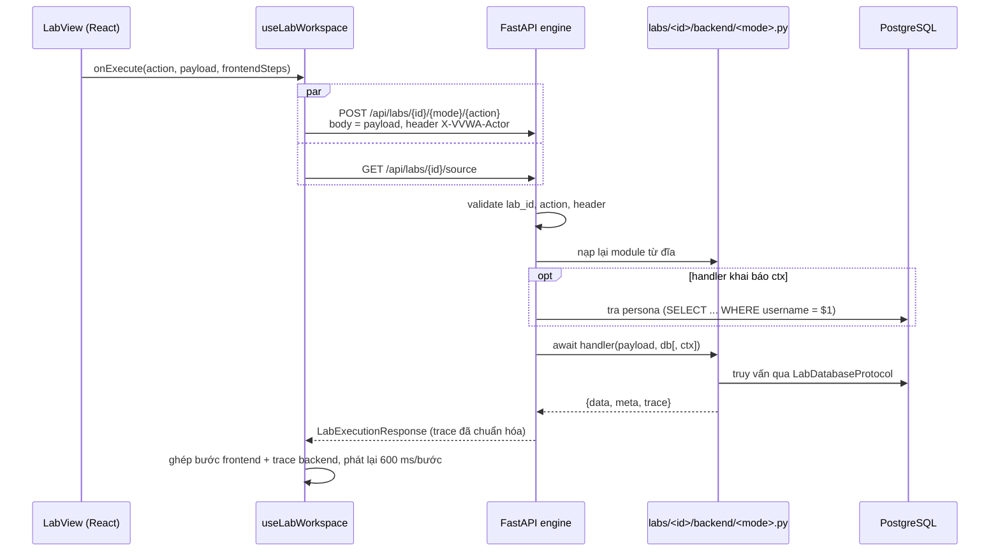
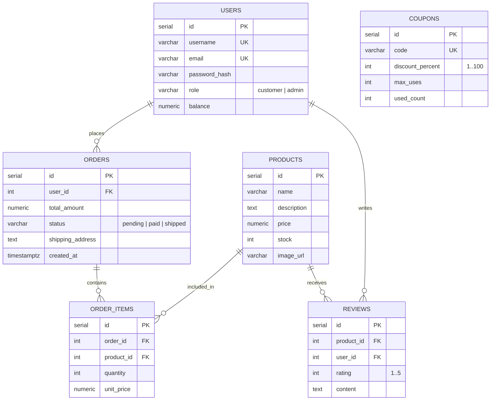

# Kiến trúc hệ thống

Tổng quan các service, luồng xử lý một request, module backend/frontend, lược đồ dữ liệu MiniShop và ranh giới bảo mật của VVWA.

## 1. Tổng quan

VVWA gồm 3 service chạy bằng Docker Compose. Một backend FastAPI duy nhất vừa là engine điều phối, vừa thực thi mã của các bài lab.



| Service | Vai trò | Volume mount |
| :--- | :--- | :--- |
| `frontend` | Workspace React, Vite dev server, proxy `/api` tới backend | `./core/frontend/src`, `./labs` |
| `backend` | Phát hiện lab, thực thi handler, đọc mã nguồn, chấm bài, reset DB | `./core/backend/app`, `./core/postgres/seed.sql` (read-only), `./labs` |
| `postgres` | Database `minishop` | `init.sql`, `seed.sql` (read-only), volume `vvwa_pg_data` |

## 2. Luồng thực thi một action



Các điểm chính:

* Module của lab được **nạp lại từ đĩa ở mỗi request** dưới một tên module ngẫu nhiên, nên sửa file trong `labs/` có hiệu lực ngay mà không khởi động lại uvicorn.
* Mọi lỗi phát sinh bên trong lab (exception, trả sai cấu trúc) được chuyển thành response `ok: false` với một bước trace `runtime-error`, không trả HTTP 500.
* Frontend gắn thêm bước trace của tầng `frontend` trước và sau trace backend, rồi đánh số lại liên tục.

## 3. Cấu trúc thư mục

```text
visual-vulnerable-webapp/
├── docker-compose.yml
├── pyproject.toml, uv.lock          # uv workspace, pin version, cấu hình Ruff/mypy/pytest/quality
├── core/
│   ├── backend/
│   │   ├── Dockerfile
│   │   ├── pyproject.toml           # Dependency backend (pin ==)
│   │   ├── app/
│   │   │   ├── main.py              # create_app(), CORS, ánh xạ lỗi miền -> HTTP
│   │   │   ├── api/                 # Router mỏng: health, labs, system + deps
│   │   │   ├── core/                # Settings, cây exception VvwaError
│   │   │   ├── db/                  # LabDatabaseProtocol, AsyncpgLabDatabase, DatabaseManager
│   │   │   ├── schemas/             # Pydantic: lab, session, source, verify, system, health
│   │   │   └── services/            # Logic miền (xem mục 4)
│   │   └── tests/
│   ├── frontend/
│   │   ├── Dockerfile, vite.config.ts, vitest.config.ts, eslint.config.js
│   │   └── src/
│   │       ├── App.tsx, main.tsx
│   │       ├── components/          # layout, sandbox, pipeline, inspector, verify
│   │       ├── hooks/               # useLabWorkspace và các hook con
│   │       ├── lib/                 # API client, trace engine, verifier, registry, highlighter
│   │       ├── types/               # Kiểu API và workspace
│   │       ├── styles/tokens.css    # Design tokens
│   │       └── __tests__/
│   └── postgres/
│       ├── init.sql                 # Schema minishop + role phân quyền
│       └── seed.sql                 # Dữ liệu mẫu, chạy lại khi Reset DB
├── labs/
│   └── <id>-<slug>/                 # meta.json, README.md, backend/, frontend/
├── scripts/
│   ├── gates.py                     # CLI chạy Quality Gates
│   ├── quality/                     # Các checker và runner
│   └── tests/
└── docs/
```

Mỗi package Python trong `core/backend/app` và `scripts/quality` có `__init__.py` với `__all__`; mỗi module frontend trong `src/{components,hooks,lib,types}` có `index.ts`. Import luôn đi qua barrel này.

## 4. Backend

| Module | Trách nhiệm |
| :--- | :--- |
| [`api/labs.py`](../core/backend/app/api/labs.py) | Endpoint danh sách, mã nguồn, tải snippet, verify và thực thi action |
| [`api/system.py`](../core/backend/app/api/system.py) | `POST /api/system/reset-db` |
| [`api/deps.py`](../core/backend/app/api/deps.py) | Dependency `Settings`, `DatabaseManager`; tách payload (không tin cậy) và actor (tin cậy) |
| [`services/lab_discovery.py`](../core/backend/app/services/lab_discovery.py) | Quét `labs/*/meta.json`, validate, bỏ qua lab lỗi kèm warning |
| [`services/lab_loader.py`](../core/backend/app/services/lab_loader.py) | Nạp module lab từ đĩa, kiểm tra action, tiêm `ctx` khi handler khai báo |
| [`services/lab_response.py`](../core/backend/app/services/lab_response.py) | Chuẩn hóa output handler thành `LabExecutionResponse`, đánh số trace, chặn tag `engine-*` |
| [`services/session_actor.py`](../core/backend/app/services/session_actor.py) | Kiểm tra header `X-VVWA-Actor`, tra persona trong DB, sinh bước `engine-session` |
| [`services/source_reader.py`](../core/backend/app/services/source_reader.py) | Kiểm tra `lab_id`, chống path traversal, parse `@snippet`/`@step`, tạo diff, đóng gói `.zip` |
| [`services/frontend_sinks.py`](../core/backend/app/services/frontend_sinks.py) | Phát hiện cặp `frontend/vulnerable.tsx` + `secure.tsx` |
| [`services/verifier.py`](../core/backend/app/services/verifier.py) | Chạy `verifyTests` tầng backend trên `vulnerable.py` |
| [`services/expect_matcher.py`](../core/backend/app/services/expect_matcher.py) | So khớp `expect` (subset, toán tử `$contains`/`$notContains`) |
| [`db/manager.py`](../core/backend/app/db/manager.py) | Pool `lab_app_user` khởi tạo lười; kết nối `lab_admin_user` ngắn hạn cho reset |
| [`db/client.py`](../core/backend/app/db/client.py) | `LabDatabaseProtocol` cấp cho lab; chuẩn hóa `Decimal` → `float`, ngày giờ → ISO string |

Ánh xạ lỗi miền sang HTTP nằm tại [`main.py`](../core/backend/app/main.py), chi tiết xem [API Reference](api-reference.md#7-mã-lỗi).

## 5. Frontend

| Module | Trách nhiệm |
| :--- | :--- |
| [`hooks/useLabWorkspace.ts`](../core/frontend/src/hooks/useLabWorkspace.ts) | Bộ điều phối trung tâm: lab, mode, payload theo lab, thực thi action, chống response cũ |
| [`hooks/useLabCatalog.ts`](../core/frontend/src/hooks/useLabCatalog.ts) | Tải health và danh sách lab khi khởi động |
| [`hooks/useLabSourceSync.ts`](../core/frontend/src/hooks/useLabSourceSync.ts) | Tải mã nguồn, tự làm mới khi cửa sổ được focus |
| [`hooks/useLabActor.ts`](../core/frontend/src/hooks/useLabActor.ts) | Persona đang chọn theo từng lab |
| [`hooks/useTracePlayback.ts`](../core/frontend/src/hooks/useTracePlayback.ts) | Máy trạng thái phát lại trace (600 ms/bước), lùi/tiến, nhảy theo tầng |
| [`hooks/useLabVerify.ts`](../core/frontend/src/hooks/useLabVerify.ts) | Test My Fix: chạy song song test backend và frontend, gộp kết quả |
| [`hooks/useLabMaintenance.ts`](../core/frontend/src/hooks/useLabMaintenance.ts) | Reset DB, tải snippet |
| [`lib/api.ts`](../core/frontend/src/lib/api.ts) | Client REST có kiểu cho mọi endpoint |
| [`lib/labRegistry.ts`](../core/frontend/src/lib/labRegistry.ts) | Phát hiện `LabView.tsx` và cặp sink qua `import.meta.glob`, lazy-load theo `lab.id` |
| [`lib/traceEngine.ts`](../core/frontend/src/lib/traceEngine.ts) | Ghép trace, tính trạng thái node pipeline, ánh xạ bước trace → tab và dòng code |
| [`lib/frontendVerifier.ts`](../core/frontend/src/lib/frontendVerifier.ts) | Render sink vào document trơ và chấm |
| [`lib/domProbe.ts`](../core/frontend/src/lib/domProbe.ts) | Quét DOM tìm `script`, `on*`, `srcdoc`, URL `javascript:` |
| [`lib/expectMatcher.ts`](../core/frontend/src/lib/expectMatcher.ts) | Bản TypeScript của matcher, cùng ngữ nghĩa với backend |
| [`lib/highlighter.ts`](../core/frontend/src/lib/highlighter.ts) | Shiki (`python`, `tsx`, `sql`) render thành token React, không dùng `innerHTML` |
| `components/` | `TopControlBar`, `ModeSwitch`, `LabWorkspace`, `SandboxPane`, `ActorSwitcher`, `PayloadChipBar`, `EmptyLabFallback`, `FlowPipeline`, `CodeInspector`, `GlowingCodeLine`, `TraceControls`, `UnifiedDiffView`, `VerifyModal` |

## 6. Lược đồ dữ liệu MiniShop

Toàn bộ bảng nằm trong schema `minishop`, do `lab_admin_user` sở hữu. Định nghĩa đầy đủ: [`core/postgres/init.sql`](../core/postgres/init.sql).



> [!NOTE]
> `password_hash` trong seed lưu dạng văn bản thuần, phục vụ các kịch bản lab. Đây không phải cách lưu mật khẩu đúng trong ứng dụng thật.

## 7. Phân quyền PostgreSQL & Reset DB

| Role | Quyền | Dùng cho |
| :--- | :--- | :--- |
| `lab_app_user` | `SELECT`, `INSERT`, `UPDATE`, `DELETE` trên bảng; `USAGE`, `SELECT` trên sequence. Không có `DROP`, `ALTER`, `TRUNCATE` | Mọi request thực thi lab, tra persona và verify |
| `lab_admin_user` | Sở hữu schema và bảng | Chỉ `POST /api/system/reset-db` |

Reset DB mở một kết nối `lab_admin_user` ngắn hạn, chạy `seed.sql` (`TRUNCATE ... RESTART IDENTITY CASCADE` rồi `INSERT`) trong một transaction và được tuần tự hóa bằng lock. Cả hai role đặt `search_path` là `minishop, public`, nên câu SQL trong lab viết `users` thay vì `minishop.users`.

## 8. Ranh giới bảo mật

| Quy tắc | Cơ chế ép buộc |
| :--- | :--- |
| Lỗ hổng có chủ đích chỉ nằm trong `labs/<id>/backend/vulnerable.py` và `labs/<id>/frontend/vulnerable.tsx` | Review + Ruff chỉ miễn nhóm cảnh báo bảo mật cho `vulnerable.py`; ESLint chặn sink HTML ngoài `vulnerable.tsx` |
| `core/`, `LabView.tsx`, `secure.*` không chứa sink | ESLint `no-restricted-syntax`: cấm `dangerouslySetInnerHTML`, gán `innerHTML`/`outerHTML`, `insertAdjacentHTML` |
| `lab_id` và tên action không thoát khỏi thư mục lab | Regex an toàn + kiểm tra đường dẫn đã resolve nằm trong `labs/` |
| Danh tính đến từ phiên, không từ payload | Header `X-VVWA-Actor` được engine kiểm tra và tra DB; handler đọc `ctx.actor` |
| Lab không giả mạo bước của engine | Tag bắt đầu bằng `engine-` do lab trả về bị từ chối |
| Chấm frontend không thực thi payload | Render vào `document.implementation.createHTMLDocument`, không gắn vào trang thật |

Lý do của từng quyết định: xem [ADR](adr/README.md), đặc biệt [ADR-0005](adr/0005-lab-session-actor-context.md) và [ADR-0006](adr/0006-frontend-sink-grading-and-verify-matchers.md).
